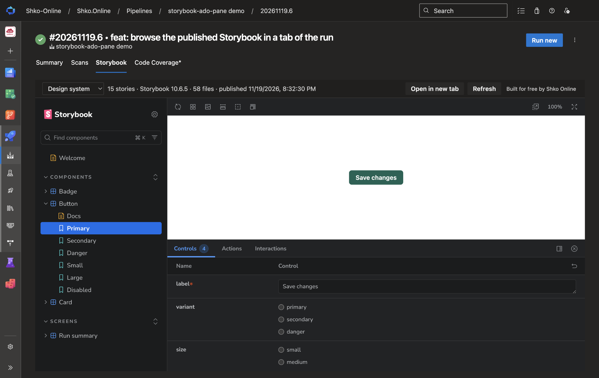
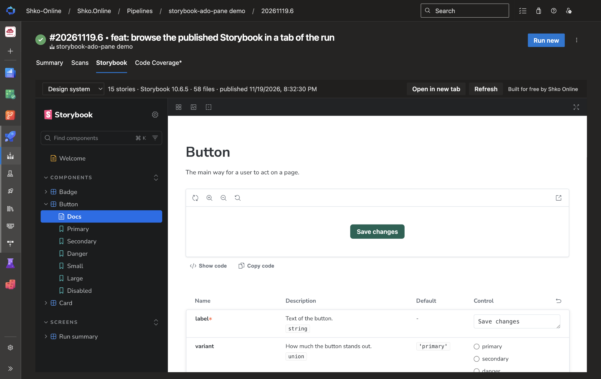
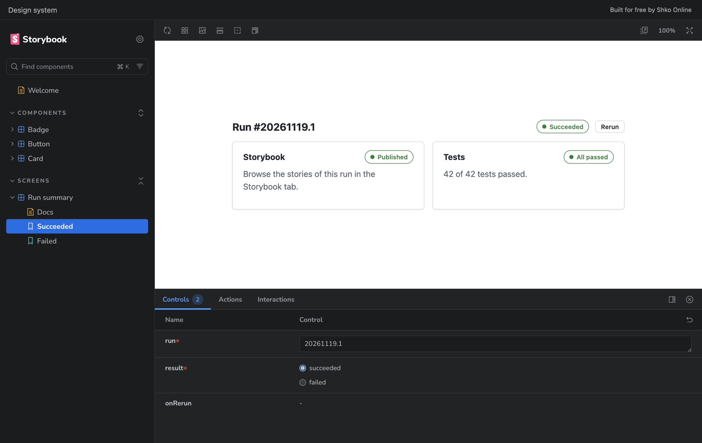

# Storybook Viewer: Azure DevOps extension

Publish a built [Storybook](https://storybook.js.org/) from Azure Pipelines and browse it in a **Storybook** tab on the run page. The Storybook is a build artifact of the run, a zip; the tab downloads it, unpacks it in memory and shows it. Nothing is deployed, and reviewers download nothing. User-facing docs live in [overview.md](overview.md), which is also the Marketplace page.

```yaml
- script: npx storybook build
  displayName: Build Storybook

- task: PublishStorybook@1
  inputs:
    storybookDir: storybook-static
```

## Screenshots

These come from a run of the [sample project](samples/demo). Its full pipeline is [samples/demo/azure-pipelines.yml](samples/demo/azure-pipelines.yml).

The run page gets a **Storybook** tab with the Storybook the run built: the sidebar, the story, and its controls. The line above it says what was published.



Documentation pages work as they do locally.



**Open in new tab** gives the Storybook the whole window, on the story you were looking at.



## How it works

```
 pipeline agent                              browser (run page → "Storybook" tab)
┌────────────────────────────┐              ┌────────────────────────────────────────────────┐
│ PublishStorybook@1         │              │ tab.html (extension iframe)                    │
│  • zips the folder         │  build       │  • lists the run's artifacts and keeps the     │
│  • ##vso[artifact.upload]  │  artifact    │    ones the task tagged (REST, vso.build)      │
│    with properties that    │ ───────────▶ │  • downloads the artifact                      │
│    tag it as a Storybook   │              │  • keeps the zip in memory (JSZip) and         │
└────────────────────────────┘              │    unpacks a file when it is asked for         │
                                            │  • <iframe src="sb/s/<session>/index.html">    │
                                            │        │ every request            ▲ the file   │
                                            │        ▼                          │            │
                                            │  sb/sw.js (service worker) ── asks tab.html    │
                                            └────────────────────────────────────────────────┘
```

**The task** ([tasks/PublishStorybook](tasks/PublishStorybook)) packs the folder into one zip ([zip.ts](tasks/PublishStorybook/src/zip.ts)) and publishes that as a regular build artifact, with the agent's `artifact.upload` command. The agent keeps every property of that command it does not know as a property of the artifact, so the task adds a few (`storybookpane`, `storybooktitle`, `storybookversion`, …, see [src/shared/constants.ts](src/shared/constants.ts)). That is how the tab tells a Storybook from the other artifacts of a run, and how it knows the title and the number of stories before downloading anything.

Why a zip, when an artifact can hold a folder: Azure DevOps handles an artifact file by file. A Storybook of 1,558 files (38 MB) took 100 seconds to upload as a folder and 34 seconds to download again; as one zip it takes 3 seconds each way.

**The tab** ([src/tab/main.ts](src/tab/main.ts)) downloads the artifact, which works from the browser for artifacts published this way: the build API answers directly, with CORS headers. (Artifacts published with `PublishPipelineArtifact` are redirected to another host, and browsers drop the `Authorization` header on such a redirect.) Azure DevOps sends an artifact as a zip of its files, so the Storybook arrives as a zip in a zip; [src/viewer/archive.ts](src/viewer/archive.ts) opens the inner one. An artifact that holds the files of a Storybook as they are is understood too.

**The service worker** ([src/sw/sw.ts](src/sw/sw.ts)) is what makes a Storybook run from memory. A Storybook is a web application: its pages load ES modules that import each other, fetch `index.json`, and show `iframe.html?id=…` in a frame, all with relative URLs. `blob:` URLs cannot do that: they are not a base for relative URLs, and module imports cannot be patched. So the worker gives the Storybook a folder of real URLs, `sb/s/<session>/…`, and answers every request below it. It stores nothing: it passes each request to the page that holds the zip ([src/viewer/host.ts](src/viewer/host.ts)) and returns that page's answer. The browser can stop and restart the worker at any time, and nothing of a Storybook is written to disk. Requests for absolute paths (`/logo.png`) from a Storybook's pages are answered from the Storybook too, so one written for the root of a site works.

**The bridge** ([src/viewer/bridge.ts](src/viewer/bridge.ts)) is a small script added to the Storybook's HTML pages. It looks after the places where a Storybook leaves its folder: links and `window.open` calls that show a story in a new browser tab, links to other sites, and a service worker of the Storybook's own.

**Links to a story.** Storybook keeps the story on screen in the query of its own address. The tab copies that into the fragment of the run page's address ([src/viewer/place.ts](src/viewer/place.ts), through the host's navigation service), and reads it back when the page is opened, so the address in the browser is a link to the story: `…/_build/results?buildId=123&view=…#path=/story/components-button--primary`.

**Open in new tab** opens [viewer.html](src/tab/viewer.html), a page of the extension. A browser tab of its own is a different storage partition from the tab embedded in Azure DevOps, with its own service worker and none of the tab's memory, so viewer.html asks the tab that opened it for the zip and serves it itself. It is also the way out when a browser does not allow service workers in embedded pages: the tab then says so and offers the new tab.

| Path | What |
| --- | --- |
| [tasks/PublishStorybook](tasks/PublishStorybook) | Pipeline task (`task.json`, `src/index.ts`) |
| [src/tab](src/tab) | Build results tab (SDK wiring, artifact source, styles) and the new-tab page |
| [src/viewer](src/viewer) | Archive, `StorybookHost`, bridge and viewer UI (shared with the dev harness) |
| [src/sw](src/sw) | Service worker |
| [src/shared](src/shared) | What the task and the tab agree on, and what the pages and the worker say to each other |
| [src/dev](src/dev) | Local harness that runs the viewer without Azure DevOps |
| [samples/demo](samples/demo) | Sample Storybook and an example `azure-pipelines.yml` |
| [scripts/fixtures/selftest](scripts/fixtures/selftest) | A page that does what Storybooks do and lists what works, to check the viewer |
| [test](test) | Tests of the task, the archive and the task–tab contract |
| [vss-extension.json](vss-extension.json) | Extension manifest |

## Develop

```sh
npm install
(cd tasks/PublishStorybook && npm install)

# the sample Storybook
(cd samples/demo && npm install && npm run build-storybook)

npm run build      # everything the .vsix needs, into build/
npm run fixtures   # runs the real task on the sample and the self-test → .fixtures/*.zip
npm run dev        # http://localhost:5173/host.html  (viewer in a frame from another site, like Azure DevOps)
                   # http://localhost:5173/dev.html   (viewer top-level, handy for devtools)
npm test
npm run typecheck
```

The harness shows the zips in `.fixtures/`, and any Storybook zip you pick. Add `?nosw` to its address to see what the tab does when the browser refuses the service worker, and `?theme=dark` or `?theme=light` for the Azure DevOps theme.

## Production and dev builds

The same code is packaged as two extensions:

| | Production | Dev |
| --- | --- | --- |
| Extension | `shko-online.storybook-ado-pane` | `shko-online.storybook-ado-pane-dev` |
| On the Marketplace | public | private, shared only with our own organization |
| Task | `PublishStorybook@1` | `PublishStorybookDev@1` |
| Released by | semantic-release, on every push to `main` | `npm run publish:dev`, from a working copy |
| Version | from the commit messages | major and minor of the latest release, and a patch from the clock |

The dev build is for internal use: to try a change in a real organization before it is released to everybody. It has an identity of its own ([vss-extension.dev.json](vss-extension.dev.json), [task.dev.json](tasks/PublishStorybook/task.dev.json)), so it can be installed next to the production extension, and a pipeline chooses between the two by the task it calls.

```sh
az login                        # once; you must be a member of the Marketplace publisher
npm run publish:dev             # package, upload as private, share with the organization
npm run publish:dev -- --install   # the first time: also install it there
```

[scripts/release/dev.mjs](scripts/release/dev.mjs) refuses to upload a package that is marked public, and to update an extension that is public on the Marketplace.

To try a dev build, run [samples/demo/azure-pipelines.dev.yml](samples/demo/azure-pipelines.dev.yml) in that organization. It is the sample pipeline with the dev build's task, and it publishes the viewer's self-test as a second Storybook: open the run's **Storybook** tab, pick *Viewer self-test*, and every line should say PASS.

## Releases

Production releases are automatic. Every push to `main` runs [.github/workflows/release.yml](.github/workflows/release.yml), where [semantic-release](https://semantic-release.gitbook.io/) picks the next version from the commit messages since the last `v*` tag:

| Commit message | Release |
| --- | --- |
| `fix: …` | patch (1.2.**3**) |
| `feat: …` | minor (1.**3**.0) |
| `feat!: …`, or a `BREAKING CHANGE:` footer | major (**2**.0.0) |
| `docs:`, `chore:`, `ci:`, `refactor:`, `test:`, `build:` … | no release |

For a release, the workflow then:

1. checks that Marketplace Trusted Publishing works, before anything is tagged;
2. packages the `.vsix`, stamping the version into the manifest and `task.json`;
3. publishes it to the Visual Studio Marketplace;
4. creates the `vX.Y.Z` tag and a GitHub Release with notes and the `.vsix` attached.

Versions live only in tags. The `0.0.0` in [vss-extension.json](vss-extension.json) and [task.json](tasks/PublishStorybook/task.json) is a placeholder, and nothing is committed back to `main`.

The task version always matches the extension version. A major release therefore moves the task to a new major, and pipelines must change `PublishStorybook@1` to `@2`. Use `!` / `BREAKING CHANGE` only for changes that really break existing pipelines.

### Marketplace authentication

Publishing uses [Trusted Publishing](https://learn.microsoft.com/azure/devops/extend/publish/overview#publish-with-oidc-trusted-publishing), so there is no PAT or secret. The workflow exchanges its GitHub OIDC token for a credential that lasts 15 minutes ([scripts/release/marketplace.mjs](scripts/release/marketplace.mjs)). This is the same exchange `vsce publish --oidc` makes.

It requires a policy on the `shko-online` publisher (Marketplace → publisher → **Trusted Publishing**):

| Field | Value |
| --- | --- |
| Repository owner | `Shko-Online` |
| Repository | `storybook-ado-pane` |
| Workflow | `release.yml` |
| Environment | `marketplace` |

### Manual packaging

```sh
npm run package -- --version 1.2.3       # out/shko-online.storybook-ado-pane-1.2.3.vsix (production)
npm run package:dev -- --version 1.2.3   # out/shko-online.storybook-ado-pane-dev-1.2.3.vsix (dev)
```

## License

[Apache License 2.0](LICENSE). See [NOTICE](NOTICE).

Storybook is a trademark of its respective owners. This extension is an independent project and is not affiliated with or endorsed by the Storybook project.
